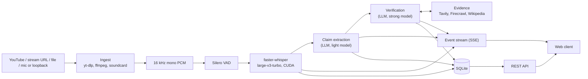

# Architecture

Footnote is two local processes that talk only through a documented contract:

- **`footnote`** (Python 3.12, FastAPI) runs the whole pipeline: ingest, voice activity detection, speech-to-text, claim extraction, evidence retrieval, verification, and storage.
- **`@footnote/web`** (React, Vite, TypeScript) is a static web client. In development Vite serves it; otherwise the backend serves the built files.

The contract lives in `packages/contracts/`: `openapi.yaml` defines every REST endpoint and every payload, including realtime events, and `asyncapi.yaml` describes the Server-Sent Events stream. Both sides generate their types from it.

## Audio in

Every source becomes one stream of 16 kHz mono PCM with timestamps derived from the sample count, so transcript times stay consistent even when processing slows down. URLs are resolved with yt-dlp and decoded by FFmpeg in a subprocess; devices are captured with `soundcard` (PipeWire/PulseAudio monitors on Linux, WASAPI loopback on Windows). Live sources reconnect with backoff and mark gaps in the transcript. Recorded media is processed as fast as transcription allows.

The backend never decodes video. The web client plays the original source itself (YouTube embed, hls.js, or a native `<video>` element) and seeks it when you select a claim.

## Transcription

faster-whisper with the `large-v3-turbo` model runs on the GPU in `int8_float16`, using about 2 to 3 GB of VRAM. Silero VAD keeps silence away from the model. A streaming strategy called LocalAgreement re-decodes the current utterance about once per second and commits words once two consecutive passes agree; committed words become final segments, the rest is shown as a tentative partial line. If transcription falls behind a live source, it decodes less often, then stops producing partials, and as a last resort skips audio and marks the gap. Without a usable GPU it falls back to the `small` model on the CPU.

## Claims

Final segments are split into sentences and sent in small batches, with a few sentences of context, to the extraction model. It returns each claim rewritten to stand on its own, its kind (statistic, historical fact, attribution, opinion, promise, and so on), a check-worthiness score, and search queries. The backend locates the exact quote in the transcript, links it to word timestamps, and merges repeated claims, but never merges two claims whose numbers differ.

## Verification

For each check-worthy claim, Footnote searches the enabled providers, fetches page text where needed, and picks the most relevant passages with BM25. The verification model sees the claim, its transcript context, and the numbered passages, and returns a label, a short rationale, and citations.

Citations are then checked mechanically: a quote must actually appear in the passage it cites, or it is dropped. A decisive label (supported, refuted, misleading, partly true) requires at least one surviving citation from an external source; otherwise the verdict becomes "cannot be verified". Confidence is computed from how many independent domains agree and how authoritative they are, not from the model's own estimate.

Verification runs from a priority queue with rate limits, a cache, retries, and a circuit breaker, so a slow or unavailable LLM delays verdicts without stopping the transcript.

## Realtime events

Each session has one Server-Sent Events stream. Every event carries a per-session sequence number and the full entity it describes, so applying an event twice is harmless. On reconnect the browser resumes from the last event id; if the server can no longer replay that far back, it tells the client to reload a snapshot over REST and continue from there.

## Storage

SQLite in WAL mode holds sessions, final segments, claims, versioned verdicts, and evidence. Uploads, archived session audio, exports, and downloaded models are files in the data directory (`~/.local/share/footnote` by default). API keys live in a separate file readable only by the user.

## Privacy

There is no telemetry. Text leaves the machine only when sent to the LLM endpoint and the evidence providers you configure. The backend binds to 127.0.0.1, validates the `Host` header, and rejects state-changing requests from other origins.
